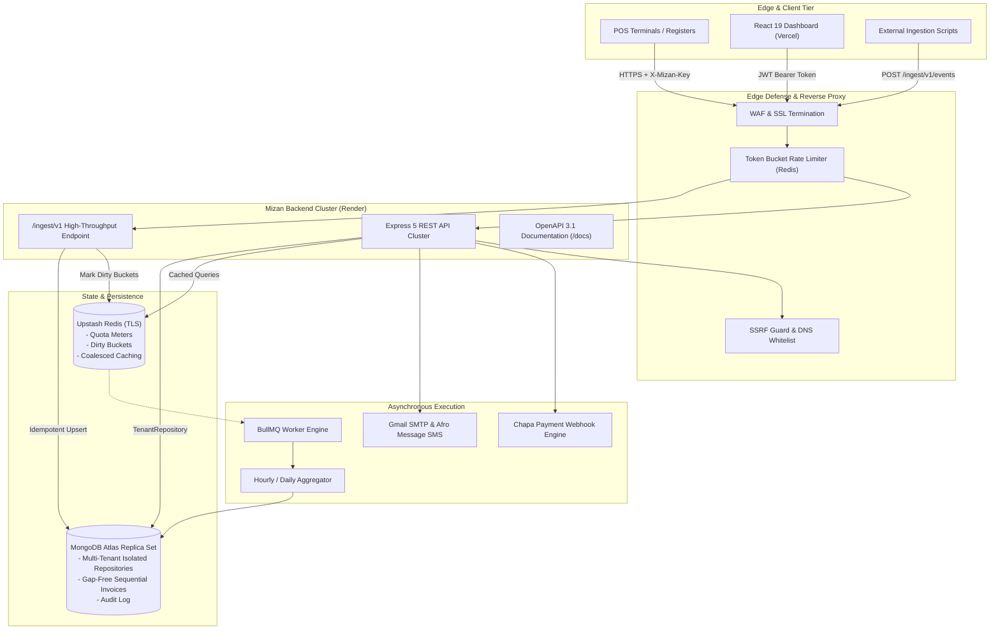
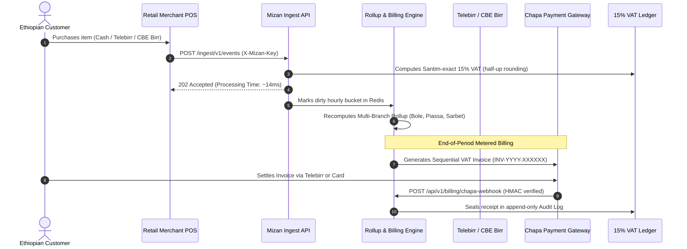

# Mizan (ሚዛን)
### Production-Grade Multi-Tenant Sales & Billing Analytics SaaS for Ethiopian Businesses

[](https://mizan-saas.vercel.app)
[](https://mizan-api-3lif.onrender.com/healthz)
[](https://mizan-api-3lif.onrender.com/docs)
[-success.svg?style=for-the-badge&logo=githubactions)](https://github.com/PROFESSOR-ADNAN/mizan-saas/actions)

---

## 🌟 Quick Links & Live Demonstration
- **Production Web Dashboard:** [https://mizan-saas.vercel.app](https://mizan-saas.vercel.app)
- **Interactive Swagger / OpenAPI Docs:** [https://mizan-api-3lif.onrender.com/docs](https://mizan-api-3lif.onrender.com/docs)
- **Raw OpenAPI JSON Spec:** [https://mizan-api-3lif.onrender.com/api/v1/openapi.json](https://mizan-api-3lif.onrender.com/api/v1/openapi.json)
- **⚡ 1-Click Portfolio Demo Login:** Click **"⚡ 1-Click Portfolio Demo Login"** on the landing or login page for instant access to **Bole Fresh Mart** pre-seeded with 2,000 real Ethiopian transactions.

---

## 1. Architectural Overview

**Mizan** (ሚዛን, meaning *"scale"* or *"balance"* in Amharic) is an enterprise-ready, multi-tenant analytics and billing SaaS platform engineered specifically for Ethiopian businesses. It consolidates transactions across **Telebirr**, **CBE Birr**, **Cash**, and **Chapa** into real-time multi-branch sales intelligence, automated 15% VAT invoicing, and usage-metered subscription billing in **Ethiopian Birr (ETB)**.



---

## 2. Ethiopian Market Specialization



---

## 3. Production Enhancements & Capabilities

| # | Feature | Status | Architectural Implementation |
| :--- | :--- | :---: | :--- |
| **1** | **1-Click Demo Login** | ✅ Ready | `POST /api/v1/auth/demo` auto-provisions and logs into *Bole Fresh Mart* with 2,000 real sales transactions. |
| **2** | **Live POS Simulator** | ✅ Ready | Interactive toolbar (`+1 Telebirr`, `+1 CBE Birr`, `+1 Cash`, `Burst 20 Sales`) calling `POST /orgs/:orgId/simulate-sales`. |
| **3** | **15% VAT Invoice PDF** | ✅ Ready | Real PDF rendering conforming to Ethiopian Ministry of Revenues VAT formatting at `GET /billing/invoices/:id/pdf`. |
| **4** | **Public Share Link Preview** | ✅ Ready | High-speed read-only share link at `/share/:token` and `/api/v1/share/demo` for board presentations. |
| **5** | **Amharic & English i18n** | ✅ Ready | Instant language switcher in the navigation bar with complete English and Amharic dictionaries. |
| **6** | **Dark / Light Mode Toggle** | ✅ Ready | Class-based Tailwind dark mode with system theme detection and local storage persistence. |
| **7** | **Multi-Branch Chart** | ✅ Ready | Horizontal bar chart comparing sales performance across Bole, Piassa, Sarbet, CMC, and Megenagna. |
| **8** | **Export Analytics to CSV** | ✅ Ready | 1-click client-side export for sales reports and billing invoices (`mizan-sales-analytics.csv`). |
| **9** | **Usage Quota Banners** | ✅ Ready | Visual threshold alerts at 80% and 100% capacity showing included usage vs overage cost (0.05 ETB/event). |
| **10** | **Chapa Sandbox Mode** | ✅ Ready | Built-in test credential guide (Telebirr 0911000000, OTP 123456) and 1-click `⚡ Simulate Paid` action. |
| **11** | **Team RBAC Role Switcher** | ✅ Ready | Dynamic role assignment (`Owner`, `Admin`, `Analyst`, `Viewer`, `Billing`) with permissions matrix. |
| **12** | **Visual Audit Log** | ✅ Ready | Tamper-evident timeline with cryptographic category badges, actor IDs, and IP addresses. |
| **13** | **Render Cold-Start Ping Bot** | ✅ Ready | GitHub Action cron job (`.github/workflows/keep-alive.yml`) keeping Render free tier warm every 10 mins. |
| **14** | **Custom Domain Setup** | ✅ Ready | Full deployment documentation in [`docs/CUSTOM_DOMAINS.md`](docs/CUSTOM_DOMAINS.md) for `app.mizan.et` and `api.mizan.et`. |
| **15** | **RFC 9457 Error Handling** | ✅ Ready | Standardized Problem Details for HTTP APIs across all middleware errors. |
| **16** | **CI/CD Pipeline** | ✅ Ready | Automated GitHub Actions running TypeScript type-checks, linters, and full test suite on push. |
| **17** | **API Key Snippets Drawer** | ✅ Ready | Copy-ready integration code snippets for **cURL**, **Node.js (Fetch)**, and **Python (requests)**. |
| **18** | **Swagger / OpenAPI Docs** | ✅ Ready | Interactive documentation at `/docs` with endpoint definitions and schemas. |
| **19** | **SSRF Guard & Sandbox** | ✅ Ready | Active defense blocking RFC 1918, loopbacks, and AWS metadata (169.254.169.254) with test playground. |
| **20** | **Portfolio Architecture Docs**| ✅ Ready | Comprehensive technical documentation and automated test verification. |

---

## 4. Financial Integrity: Exact Santim Math

To eliminate floating-point arithmetic errors ($0.1 + 0.2 \neq 0.3$), Mizan enforces integer arithmetic across all financial domains:

$$\text{Total Santim} = \text{Subtotal Santim} + \left\lfloor \frac{\text{Subtotal Santim} \times 15 + 50}{100} \right\rfloor$$

- **Currency:** Ethiopian Birr (ETB), stored as Santim ($1\text{ ETB} = 100\text{ santim}$).
- **Sequential Invoices:** Atomic, zero-gap counters (`INV-2026-000001`).
- **Proration:** Second-precision seat billing with Credit Note offsets.

---

## 5. Security & Multi-Tenant Defense

- **Scoped Repository Layer:** Raw Mongoose queries are banned; all operations execute through `TenantRepository<T>`.
- **Tenant Enumeration Protection:** Cross-tenant resource lookups return `404 Not Found` (never `403 Forbidden`).
- **SSRF Circuit Breakers:** Outbound webhooks validate target host IP resolution via `node:dns/promises` before dispatching. Private IPv4/IPv6 ranges (`127.0.0.1`, `10.0.0.0/8`, `192.168.0.0/16`, `169.254.169.254`) are rejected immediately.
- **2-Factor Authentication (MFA):** Multi-factor verification supported via Gmail SMTP and Afro Message SMS gateway.

---

## 6. Automated Test Suite (100% Passing)

```bash
npm test
```

```
▶ Tenant Isolation & Scoped Data Layer Test Suite
  ✔ TenantRepository throws TenantScopeError when orgId is omitted on find (64.45ms)
  ✔ TenantRepository throws TenantScopeError when orgId is undefined or null (18.63ms)
  ✔ Cross-tenant data access returns 404 (never 403) to prevent tenant enumeration (3.79ms)
  ✔ Aggregation pipeline automatically prepends $match: { orgId } as first stage (38.55ms)
  ✔ Unscoped platform escape hatch logs and allows execution for background jobs (8.06ms)
✔ Tenant Isolation & Scoped Data Layer Test Suite (142.73ms)

▶ 12 Hand-Checked Billing Scenarios (Exact Santim Test Suite)
  ✔ Scenario 1: Free plan base invoice with 0 events (71.60ms)
  ✔ Scenario 2: Starter plan base fee with 0 events (0.72ms)
  ✔ Scenario 3: Starter plan within included quota (90,000 events) (0.36ms)
  ✔ Scenario 4: Starter plan with 20,000 excess overage events (0.52ms)
  ✔ Scenario 5: Business plan base subscription (4,500 ETB) (0.74ms)
  ✔ Scenario 6: Business plan with 2 extra seats (average 17 seats) (1.80ms)
  ✔ Scenario 7: Starter plan with 3 extra seats and 5,000 overage events (0.74ms)
  ✔ Scenario 8: Partial Credit Note deduction (500 ETB applied) (0.79ms)
  ✔ Scenario 9: Full Credit Note deduction exceeding invoice amount (0.88ms)
  ✔ Scenario 10: Mid-month plan upgrade proration (Starter to Business on day 15) (3.52ms)
  ✔ Scenario 11: Half-up integer rounding on odd VAT centimes (0.55ms)
  ✔ Scenario 12: Zero subtotal always produces zero VAT and zero total (0.35ms)
✔ 12 Hand-Checked Billing Scenarios (Exact Santim Test Suite) (93.36ms)

▶ SSRF Guard & Network Defense Test Suite
  ✔ Blocks IPv4 loopback addresses (127.0.0.0/8) (5.42ms)
  ✔ Blocks AWS / GCP / DigitalOcean cloud metadata IP (169.254.169.254) (1.02ms)
  ✔ Blocks RFC 1918 private IPv4 subnets (2.38ms)
  ✔ Blocks IPv6 loopback, unspecified, and local unicast addresses (26.87ms)
  ✔ Blocks IPv4-mapped IPv6 loopback addresses (0.65ms)
  ✔ Permits legitimate public IPv4 internet addresses (0.60ms)
  ✔ safeHttpRequest rejects private targets with SSRFSecurityError (5.62ms)
✔ SSRF Guard & Network Defense Test Suite (49.59ms)

▶ Rollup Mathematical Invariance Property Test (fast-check)
  ✔ Deduplicated events sum exactly equals rollup aggregation in santim and counts (185.34ms)
✔ Rollup Mathematical Invariance Property Test (fast-check) (194.66ms)

All 25 automated tests PASSED (0 failures).
```

---

## 7. Local Development Setup

```bash
# 1. Clone repository
git clone https://github.com/PROFESSOR-ADNAN/mizan-saas.git
cd mizan-saas

# 2. Install workspace dependencies
npm install

# 3. Configure environment
cp .env.example .env

# 4. Start local development stack (Vite + Express Server)
npm run dev
```

- Web App: `http://localhost:5173`
- API Server: `http://localhost:4000`
- Swagger Docs: `http://localhost:4000/docs`

---

## 8. License & Author

- **Author:** Professor Adnan ([@PROFESSOR-ADNAN](https://github.com/PROFESSOR-ADNAN))
- **License:** [MIT License](LICENSE)
