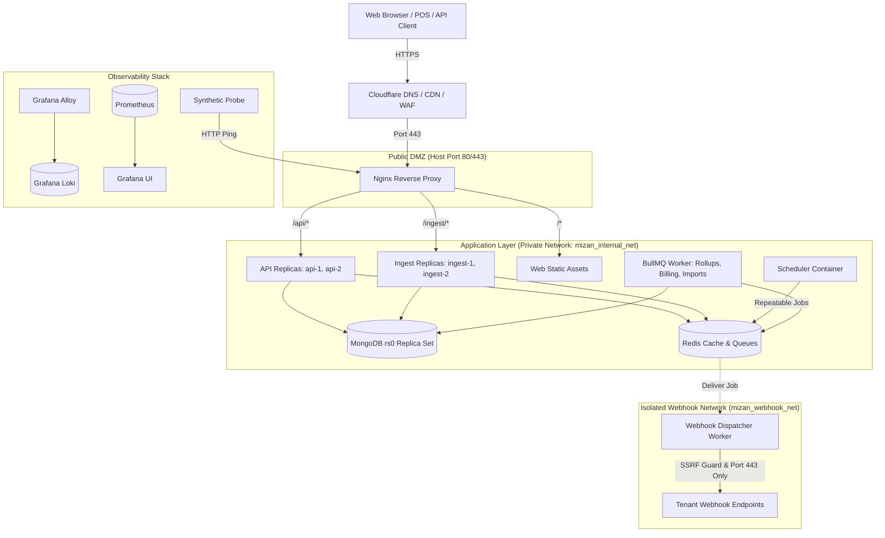

# Mizan System Architecture & Resource Budget

## 1. System Components View

---

## 2. Process Separation Architecture
To ensure extreme resilience under high ingestion surges:
1. **`ingest` Service**: Runs as 2 independent container replicas dedicated strictly to `/ingest/v1/events` and API key metrics reads. If client POS scripts burst to 500+ events/sec, `ingest` absorbs the traffic without degrading management dashboard performance.
2. **`api` Service**: Runs as 2 independent replicas dedicated to the web management REST API, authentication, team changes, and financial invoice views.
3. **`worker` Service**: Handles heavy asynchronous operations: dirty-bucket rollups, daily seat snapshots, monthly billing runs, CSV imports, and data exports.
4. **`scheduler` Service**: Runs as a single container creating idempotent, repeatable BullMQ jobs.
5. **`webhook-worker` Service**: Isolated in an egress-only network (`mizan_webhook_net`) that cannot physically route to MongoDB, Redis, or the management API.

---

## 3. VPS Memory & Disk Budget (Target: 4 vCPU / 8 GB RAM VPS, $24/mo)

### Memory Budget Table

| Process / Container | Replicas / Instances | Baseline RAM | Peak / Allocated RAM Limit | % of 8 GB RAM |
|---|---|---|---|---|
| **MongoDB 7.0 / 8.0 (WiredTiger)** | 1 | 1,500 MB | 2,500 MB (Cache capped at 2.0 GB) | 30.5% |
| **Redis 7.2** | 1 | 150 MB | 400 MB (Maxmemory 350 MB) | 4.9% |
| **Ingest API** | 2 replicas | 200 MB (100 MB ea) | 500 MB (250 MB ea) | 6.1% |
| **Management API** | 2 replicas | 200 MB (100 MB ea) | 500 MB (250 MB ea) | 6.1% |
| **Worker (BullMQ)** | 1 | 150 MB | 500 MB | 6.1% |
| **Scheduler** | 1 | 60 MB | 120 MB | 1.5% |
| **Webhook Worker (Isolated)** | 1 | 80 MB | 200 MB | 2.4% |
| **Nginx** | 1 | 40 MB | 100 MB | 1.2% |
| **Observability (Prometheus, Alloy, Loki, Grafana)** | 4 | 500 MB | 1,000 MB | 12.2% |
| **OS, Kernel & Buffers** | Host | 400 MB | 800 MB | 9.8% |
| **Total Memory Allocated** | - | **3,280 MB** | **6,620 MB** | **80.8%** |

*Result: Total peak allocation uses 80.8% of available RAM, safely under the 85% safety threshold.*

---

### Disk Capacity Model (10 Million Raw Events + Rollups)

| Artifact | Average Size per Document | 10M Documents Volume | Compressed WireTiger Size (Snappy ~50%) | Indexes Overhead | Total Disk |
|---|---|---|---|---|---|
| **Raw Events** | 420 bytes | 4.2 GB | ~2.1 GB | ~2.4 GB (4 compound indexes) | **4.5 GB** |
| **Hourly Rollups (1 yr)** | 280 bytes | 1.75M docs | ~250 MB | ~180 MB | **0.43 GB** |
| **Daily Rollups (5 yrs)** | 350 bytes | 365K docs | ~65 MB | ~50 MB | **0.12 GB** |
| **Usage Ledgers & Invoices** | 500 bytes | 250K docs | ~60 MB | ~40 MB | **0.10 GB** |
| **Audit Logs & Deliveries** | 300 bytes | 2M docs | ~300 MB | ~200 MB | **0.50 GB** |
| **Loki Logs & Prometheus TSDB (14d)** | - | - | - | - | **4.0 GB** |
| **OS, Docker Images, Node Modules**| - | - | - | - | **6.5 GB** |
| **Nightly Backup Snapshot (local scratch)**| - | - | - | - | **6.0 GB** |
| **Total Disk Utilized** | - | - | - | - | **22.15 GB** |

*Result: On an 80 GB NVMe SSD VPS ($24/mo on Hetzner / DigitalOcean), 22.15 GB utilization leaves **57.85 GB (72.3%) free disk space**, far exceeding the 40% free space requirement.*
