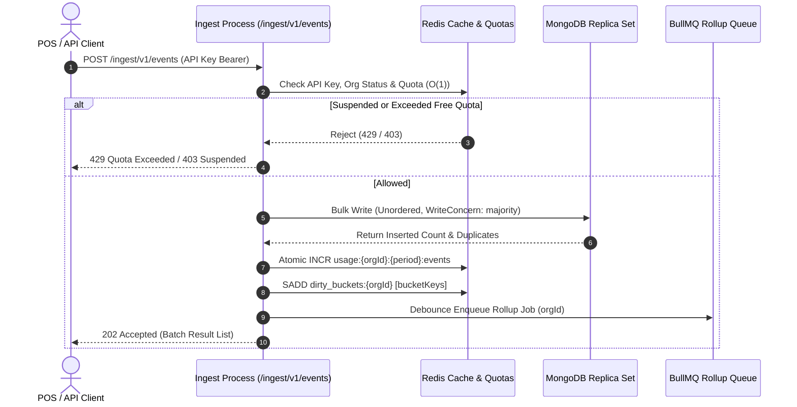
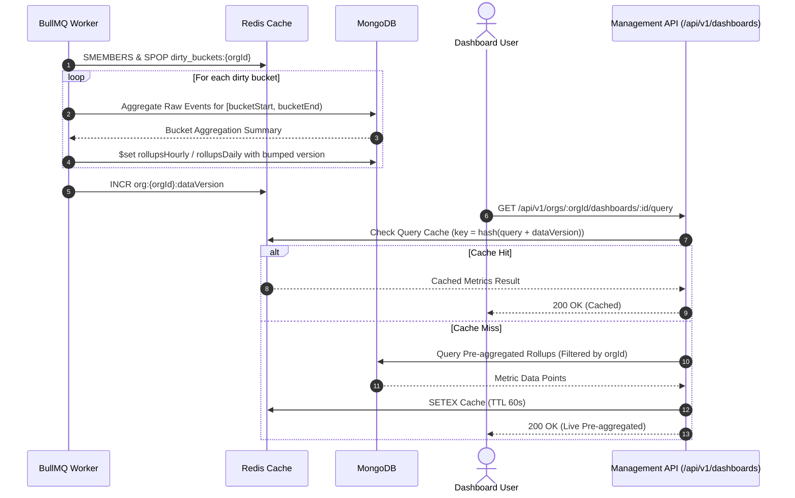
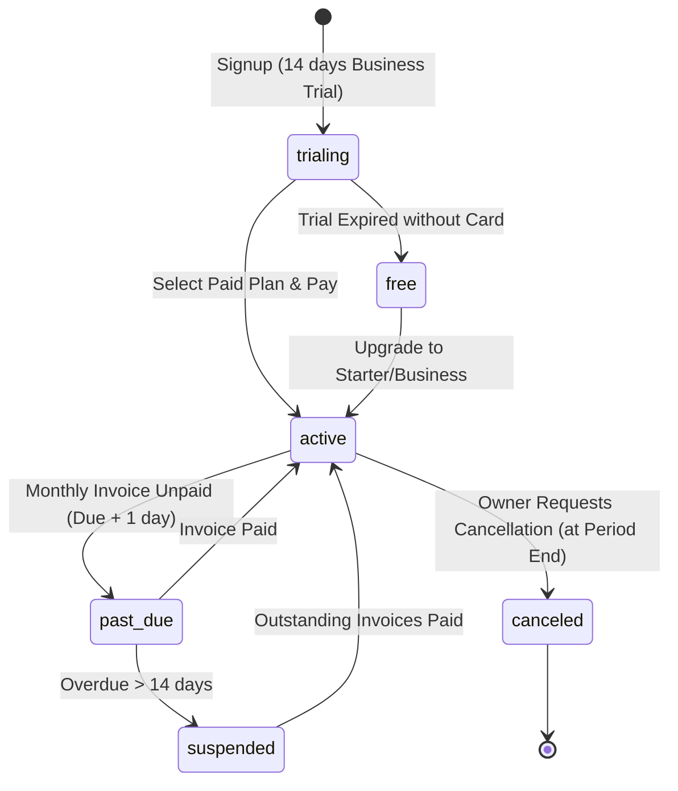
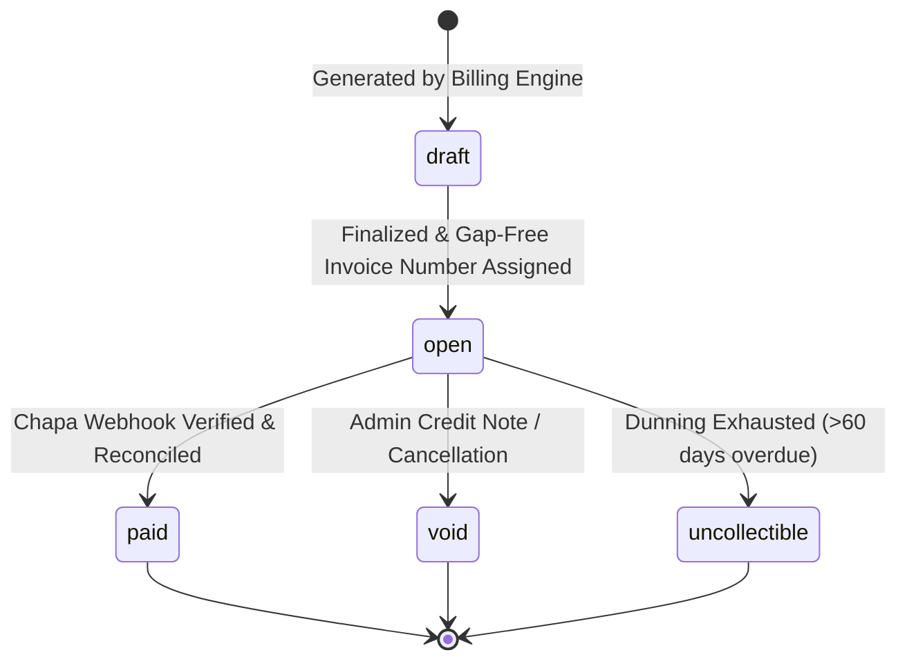
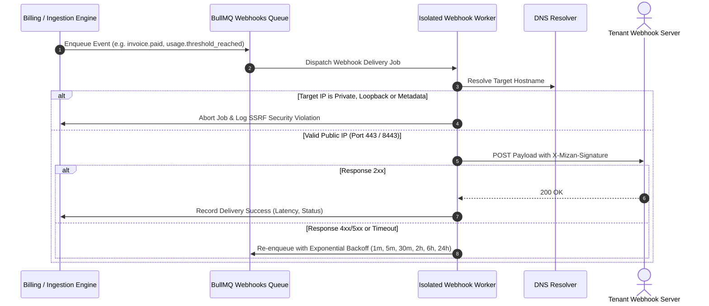

# Mizan Core Domain Workflows & Architecture

## 1. Domain Architecture Overview

Mizan operates on high-volume financial and sales event streams from Ethiopian businesses. It separates the write-heavy event ingestion path from the read-heavy analytics dashboard path and the asynchronous billing state machine.

---

## 2. Ingestion Pipeline Sequence

---

## 3. Rollup & Query Pipeline Sequence

---

## 4. Subscription State Diagram

---

## 5. Invoice State Diagram

---

## 6. Outbound Webhook Delivery Sequence

---

## 7. Data Flow Summary
1. **Event Ingestion**: Writes raw events durably to MongoDB with client deduplication. Redis quota counters increment synchronously.
2. **Rollup Processing**: Dirty buckets trigger asynchronous background aggregations updating `rollupsHourly` and `rollupsDaily`.
3. **Usage & Metering**: Hourly jobs tally MongoDB events, appending to `usageLedger` for financial billing. Drift between Redis and MongoDB triggers automatic resynchronization.
4. **Billing Engine**: Executed at midnight of the Ethiopian billing cycle end date (`Africa/Addis_Ababa`). Line items (base plan fee, daily-averaged prorated seat charges, overage tiers, and 15% VAT) are computed and sealed with a sequential gap-free invoice number.
5. **Chapa Payments**: User redirected to Chapa; webhook verifies HMAC SHA256 and calls Chapa verify endpoint to seal invoice.
6. **Outbound Webhooks**: Delivered through network-isolated containers with strict SSRF defense.
